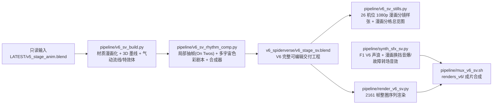

# V6 企划案：《蜘蛛侠：纵横宇宙》风格化赛车短片（Spider-Verse Stylized Edition）

基于现有已通过全量物理与视线校验的 [v5_stage_anim.blend](file:///D:/项目session/blender-supercar/LATEST/v5_stage_anim.blend)（银石整圈 `90.04 s` / `2161` 帧 / `26` 机位），另起一套**完全独立、零破坏**的 **V6 风格化分支**，在 **Blender 5.3.0 EEVEE（纯 CPU）** 下复现索尼动画《蜘蛛侠：纵横宇宙》（*Across the Spider-Verse*）标志性的**“手绘美漫印刷 × 表现主义水彩 × 次世代赛博霓虹”**视觉语言。

> [!IMPORTANT]
> **完全隔离原则**：V5 的 [LATEST/](file:///D:/项目session/blender-supercar/LATEST/)、[pipeline/v5_*.py](file:///D:/项目session/blender-supercar/pipeline/v5_anim.py) 与 [renders_v5/](file:///D:/项目session/blender-supercar/renders_v5/) 保持 **100% 只读不动**。所有 V6 代码、贴图、工程与成片独立存放在 `pipeline/v6_*.py`、`v6_spiderverse/`（工程与专属贴图）及 `renders_v6/` 下。

---

## 1. 整体管线架构与数据流

经实测探针验证，本机 **Blender 5.3.0 EEVEE** 原生具备实现《纵横宇宙》画风所需的全部核心节点：`ShaderNodeShaderToRGB`、材质背面剔除（`use_backface_culling` + `use_backface_culling_shadow`）、合成器**各向异性水彩滤镜（`CompositorNodeKuwahara`）**，以及 `Normal` / `Mist` / `Z` / `Emit` / `Cryptomatte` 多通道输出。

---

## 2. 《纵横宇宙》六大核心视觉支柱（Blender 5.3 纯 CPU 落地方案）

### 支柱一：三幕“平行宇宙”色彩剧本（Dimensional Color Script）
不同于第一部单一的美漫网点风，《纵横宇宙》最大的美学突破是**不同宇宙拥有截然不同的绘画媒介与情绪配色**。我们将银石整圈 26 个机位按赛道段落与 108 BPM 拍点划分为**三大视觉维度**（切镜处配 2 帧故障色散/漫画撕裂转场）：

| 篇章 | 机位区间 | 赛道段落 | 致敬维度 | 视觉与色彩特征 |
|---|---|---|---|---|
| **Act I：经典美漫印刷** | `S01`–`S09`（`f=1..788`） | 发车直道 → Village 发夹弯 → Wellington 直道 | **Earth-1610（迈尔斯宇宙）** | 普鲁士深蓝暗部 + 电光青/绯红双色轮廓光；清晰 **Ben-Day 半调圆点**高光过渡 + 45° 手绘钢笔排线阴影 |
| **Act II：表现主义水彩** | `S09b`–`S18`（`f=789..1601`） | Brooklands → Copse 高速弯 → Maggotts 连续 S 弯 | **Earth-65（格温宇宙）** | 湖蓝/洋红/暖金情绪化水彩晕染天空；远景看台与草地经 **Kuwahara 水彩笔触滤镜**化为色块，赛车以锐利墨线劈开色块 |
| **Act III：2099 赛博极速 × 朋克冲击** | `S19`–`S26`（`f=1602..2161`） | Hangar 331 km/h 极速直道 → Stowe 重刹 → 冲线 | **Earth-928（2099 新纽约）+ Spider-Punk** | 黑曜石高反差紫黑路面 + 霓虹赤红激光尾流与刹车热环；重刹/升挡瞬间触发**黑白红高反差冲击帧（Impact Frames）**与放射速度线 |

### 支柱二：阶梯冷暖光影 + 屏幕空间半调网点（Ben-Day Dots）+ 钢笔排线（Hatching）
封装统一程序化节点组 `NG_SV_ComicSurface`，批量接管车身 244 个部件与赛道 364 个环境网格：
- **冷暖色温阶梯化（拒绝死黑阴影）**：`Diffuse BSDF -> ShaderToRGB -> Constant/Cardinal ColorRamp`，暗部推向深靛蓝/紫罗兰，受光面保留高饱和车队主色，高光边缘叠加硬边电光青/琥珀金 Rim Kick（`Layer Weight -> Facing`）。
- **屏幕坐标锁定网点与排线**：使用 `Texture Coordinate (Window)` 乘屏幕宽高比驱动高频圆点阵列（亮部交界）与斜向平行排线（暗部交界），保证镜头推拉摇移时网点具备真实**漫画纸张印刷质感**，绝不随模型拉伸模糊。
- **路面反光铁律延续**：所有沥青/路肩材质转为哑光漫画色块 + 手绘飞白颗粒刷痕，保留 V5 零太阳白楔反光优势。

### 支柱三：双层可变线宽手绘墨线（避开 CPU LineArt 性能陷阱）
668 个对象若每帧跑 Grease Pencil LineArt CPU 全场景遮挡求交，单帧耗时会暴涨至 8–12 秒。我们采用**电影级双层混合墨线架构**（单帧仅增加 `< 0.3 s`）：
1. **3D 英雄车体轮廓墨线（Inverted-Hull Solidify）**：仅对赛车核心外壳、前后翼、轮胎与 Halo 挂载翻转法线 `Solidify` 修改器（`use_backface_culling=True` 且关闭阴影投射），叠加 3D 噪波微扰让线条呈现**毛笔/针管笔的粗细呼吸感**；同时在鼻锥、侧箱、尾翼端板绘制内部结构分件墨线。
2. **合成器全场景法线 + 深度墨线（Normal + Mist Edge Ink）**：开启 `Normal` 与 `Mist/Z` 通道，在 Compositor 中用 Sobel 边缘算子提取全场景结构折角与剪影线，并按 `Mist` 距离衰减远景线重，做到**近景赛车笔触刚劲、中景路肩护栏清晰、远景水彩自然消融**。

### 支柱四：焦外 CMYK 印刷错版（替代传统光学高斯虚化）
《蜘蛛侠：纵横宇宙》最具辨识度的镜头发明：**合焦平面（赛车主体）100% 锐利套准，而焦外背景不靠糊成一团，而是分裂成青（Cyan）/ 品红（Magenta）/ 黄（Yellow）错位重影**。
- 利用 `Cryptomatte`（精准抠出赛车与 3D 特效体）结合 `|Z - FocusDist|` 焦距差遮罩：
  - **合焦区（赛车）**：零错位、硬朗墨线与清晰涂装贴花；
  - **焦外区（背景看台/护栏/天桥/远山）**：叠年轻微 `Kuwahara` 水彩笔触概括化 + 随离焦距离线性增大的红青通道水平/垂直像素偏移（`CompositorNodeSeparateColor` + `Translate` + `CombineColor`）。

### 支柱五：3D 漫画气动流线、轮速残影与冲击帧（3D Action FX）
全部绑定在骨架或相机空间下，存入独立集合 `V6_09_ComicFX`（可随时一键开关）：
- **尾翼端板涡流飘带 & 底盘气流线**：车速 `> 230 km/h`（尤其 `DRS` 开启段）在尾翼两端拉出阶梯发光漫画流线，形状每 2 帧跳变一次模拟手绘逐帧特效；
- **轮胎漫画旋转残影环（Wheel Smear Arcs）**：在高速旋转轮胎侧面叠加不对称漫画弧形速度线，解决抽帧下车轮视觉停滞问题；
- **换挡回火漫画星芒 & 冲击帧（Impact Frames）**：在 `S02`/`S19` 车载升挡瞬间及 `S20` Stowe 大直道末 `331 -> 110 km/h` 重刹入弯拍点，插入 1–2 帧高反差黑白红闪白冲击效果与相机边缘漫画放射速度线。

### 支柱六：“一拍二”（On Twos / 12 fps）防频闪抽帧动画法则
> [!WARNING]
> **高速追随镜头的抽帧陷阱**：F1 赛车最高时速 `92 m/s`（每帧位移 `3.8 m`）。如果把赛车世界坐标 `Bone_Root` 改成 12 fps 阶梯保持（每 2 帧跳 `7.6 m`），而追随相机按 24 fps 平滑移动，赛车会在画面中心每帧前后瞬移 `3.8 m` 造成严重频闪！

**索尼动画同款解法（世界轨迹同步 + 局部动态抽帧）**：
- **世界大位移保持耦合**：`Bone_Root` 位移、`Bone_Heading` 航向与相机轨迹保持同频（24 fps 丝滑运镜），确保构图绝对稳定；
- **车身局部姿态与特效全面“一拍二”（12 fps `CONSTANT` 阶梯插值）**：车身俯仰/侧倾（`Bone_Body`）、前轮转向角、车载方向盘转动、换挡灯跳变、气动涡流飘带抖动、排气管回火星芒全部按 **2 帧一卡（12 fps）** 阶梯跳变，既有 24 fps 极速飙车的流畅镜头运动，又有手绘动画顿挫有力的卡点质感！

---

## 3. 目录与交付物规划

| 路径 | 说明 |
|---|---|
| `pipeline/v6_sv_textures.py` | 生成漫画网点母版、手绘排线贴图、水彩纸纹噪波、漫画涂鸦风赛道广告牌/刹车牌（`BOOM` / `DRS` / 漫画字体 `150-100-50`）至 `v6_spiderverse/textures/` |
| `pipeline/v6_sv_build.py` | 读取 `LATEST/v5_stage_anim.blend`，构建 `NG_SV_ComicSurface` 漫画材质库、车体 Solidify 墨线、3D 气动流线与车轮残影环、三幕平行宇宙灯光/天空关键帧 |
| `pipeline/v6_sv_comp.py` | 配置局部 `On Twos` 抽帧、ViewLayer 多通道与 Blender 5.3 合成器（Kuwahara 水彩远景 + 法线深度墨线 + 焦外 CMYK 错版 + 冲击帧 + 纸纹暗角），输出 `v6_spiderverse/v6_stage_anim_sv.blend` |
| `pipeline/v6_sv_stills.py` | 渲染全部 26 机位 1080p 风格化静帧（`renders_v6/stills/`）+ **美漫不规则分格排版总览海报**（`renders_v6/stills/comic_page_sheet.jpg`） |
| `pipeline/synth_sfx_sv.py` & `mux_v6_sv.sh` | 在 V5 遥测引擎声基础上叠加《纵横宇宙》标志性的低频 Sub-bass 冲击、漫画故障撕裂转场音（Dimension Glitch）与清脆卡点音效 |
| `docs/README_V6_SPIDERVERSE.md` | V6 视觉原理、节点参数表、单帧/全片复现指南与开关说明 |

---

## 4. Swarm 并行拆解与预算评估

- **CPU 渲染耗时预算**：由于关闭了昂贵的物理光线追踪反射（`use_raytracing = False`，美漫高光完全由 `ShaderToRGB` 与法线边缘直接解析计算！），即便增加 Solidify 墨线与 Compositor Kuwahara/CMYK 节点，预计 **1080p 单帧纯 CPU 耗时反而可压至 `1.4–2.2 s/帧`**（整圈 2161 帧约 **55–75 分钟**，26 张代表样张仅需 **~50 秒**）。
- **Swarm 四人无冲突编组**（确认方案后立即启动）：
  1. **`sv-lookdev`**：负责 `v6_sv_textures.py` + `v6_sv_build.py`（漫画材质节点组、半调网点/排线、车体 3D 墨线、3D 气动流线与车轮残影特效体）；
  2. **`sv-comp`**：负责 `v6_sv_comp.py` + `v6_sv_stills.py`（三幕宇宙色彩剧本关键帧、局部 On-Twos 抽帧、Kuwahara + 法线墨线 + 焦外 CMYK 错版合成器、26 张样张与漫画分格海报）；
  3. **`sv-audio`**：负责 `synth_sfx_sv.py` + `mux_v6_sv.sh`（维度切换 Glitch 音效、重刹冲击 Sub-drop 与配乐混音）；
  4. **`sv-verifier`**：负责 26 机位出图指标检验（墨线连续性、焦外 CMYK 错版幅度、无过曝死黑、帧耗时 `< 2.5 s`）与文档核对。

---

## 5. 待确认的 3 个创作偏好（可直接按推荐默认执行）

1. **视觉维度模式**：
   - **方案 A（推荐）**：**三幕维度流转**（整圈依次经历 *迈尔斯美漫网点* → *格温水彩表现主义* → *2099 赛博霓虹冲击*，完美契合“纵横宇宙”主题）；
   - **方案 B**：**全片统一单一画风**（如全程迈尔斯经典美漫网点风，或全程 2099 赛博漫画风）。
2. **漫画拟声词 / 平面 HUD 贴片（Onomatopoeia / Graphic Callouts）**：
   - **方案 A（推荐）**：**克制的速度图形风**（保留 3D 气动流线、速度线、冲击帧与漫画风赛道牌，**不**在画面中央弹大号英文字母拟声词，兼顾高级电影感与赛车速度感）；
   - **方案 B**：**纯正美漫分镜风**（在换挡/漂移过弯处加入 3D 空间悬浮漫画拟声词如 `VROOM!` / `SNAP!` / `331 KM/H` 分镜框）。
3. **首轮交付目标**：
   - **方案 A（推荐）**：先构建完整 V6 工程并直出 **26 机位 1080p 风格化样张 + 美漫分格总览海报 + 3 段动态试片（各 4 秒：发车/水彩弯道/极速重刹，含音效）** 供你快速审片调优，确认画风惊艳后再跑整圈 2161 帧；
   - **方案 B**：做完直接一口气跑满 2161 帧整圈成片。
