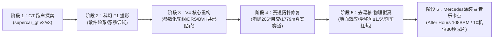

# SCIFI F1 2035 赛车项目进度总结与瘦身交付报告

---

## 1. 项目全景演进历程

本项目经历了从原型探索、重构升级到专业赛车物理调校与声画卡点成片的 6 个关键阶段：



---

## 2. 阶段核心技术成果与解决的关键问题

### 2.1 建模与气动外形重构 (V4 升级)
* **四轮总成闭合重构**：彻底重构了早期版本轮辋与轮胎分离、自转错位的散件问题；按 F1 真实规格重建 714mm 外径、前 345mm / 后 425mm 宽的光头胎，带有真实胎肩弧度与胎冠微拱。
* **双翼片气动尾翼与 DRS**：构建 0.30m 弦长主翼片 + 动态 DRS 副翼与液压作动筒，收窄端板（±0.50m）带倒角处理。
* **地面效应文丘里扩散器**：重做底部弧形引流板与 6 片顺气流导向栅，替代旧版外突的刀片网格。
* **BVH 射线投影贴花**：使用 BVH 表面投射生成与车身完全共形的贴花网格，彻底解决了悬浮贴纸面卡、地面穿模拉伸的问题。
* **材质系统**：程序化各向异性斜纹碳纤维微凹凸、Pirelli 橡胶微观颗粒、钛合金排气热应变变色及刹车盘高温自发光。

### 2.2 专业赛车骨架体系 (`RIG_F1_Race`)
* **19 根分级控制骨骼**：采用 `Bone_Root` $\rightarrow$ `Bone_Heading` $\rightarrow$ `Bone_Body` $\rightarrow$ `Bone_Susp_*` $\rightarrow$ `Bone_Hub_*` $\rightarrow$ `Bone_Wheel_*` 的真实机械级联。
* **刚性 Parent 绑定**：全车 236 个零件分类刚性绑定，转向节、刹车卡钳与车轮轴分离旋转。
* **无 Python 依赖驱动器**：全部控制参数（前轮转角 `steer`、方向盘 5:1 联动、车轮转速 `wheel_spin`、后轮打滑 `rear_slip`、DRS 开度、刹车盘发光 `brake_heat`、悬挂行程 `susp_f/r`）采用原生简单表达式，视口实时回放无需外部脚本环境。

### 2.3 赛道几何与空气动力学回归
* **赛道自交彻底修复**：早期版本弯道曲率累加至 206° 导致赛道闭合成环自交；重构为标准 F1 结构：发车长直道 $\rightarrow$ T1 右 90°（$R=85\text{m}$，弯速 $132\text{km/h}$） $\rightarrow$ 短直道 $\rightarrow$ T2 左 90°（$R=83\text{m}$，弯速 $162\text{km/h}$） $\rightarrow$ 冲线直道，总长 1,779 米，非相邻中心线间距 $\ge 30\text{m}$。
* **去漂移化·真实地面效应物理**：将早期夸张的街车漂移滑移角（$25^\circ+$）降至真实干地 F1 极限的 **$1.5^\circ$ 以内**，前轮转角限制在 $\pm 5^\circ$，车身侧倾 $\le 2^\circ$，移除街车胎痕与拉烟，还原下压力赛车高速贴地过弯质感。

### 2.4 Mercedes-AMG 涂装与《After Hours》108 BPM 运镜卡点
* **涂装进化**：从早期的红牛测试涂装切换为 Mercedes-AMG PETRONAS 裸碳黑色车身、银色渐变鼻锥、Halo 赞助商字样及经典 Petronas 青绿动感饰条。
* **音频自相关与卡点编排**：选用 The Weeknd 《After Hours》108 BPM（拍长 0.5556s = 13.334 帧 @24fps），240.814s 起 8 拍强拍进入，全片 10 个镜头全部精准吸附于强弱节拍点。

---

## 3. 项目瘦身对比指标

本次瘦身将分散于各目录的历史探索文件、中间步骤 blend、数百个冗余测试渲染帧全部归档剥离，仅在 Session 根目录下建立独立的精简发布版文件夹：

| 指标项 | 原始开发目录 (`blender-supercar`) | 瘦身交付版 (`blender-supercar-slim`) | 瘦身效果 |
|---|---|---|---|
| **文件夹位置** | `D:\项目session\blender-supercar` | `D:\项目session\blender-supercar-slim` | 独立目录发布 |
| **文件总数** | 1,147 个文件 | **43 个文件** | **减少 96.3%** |
| **占用体积** | 384.8 MB | **56.2 MB** | **瘦身 85.4%** |
| **剥离内容** | 720 张序列帧、150 张旧漂移帧、4 个旧版测试视频、冗余中间 blend/blend1、临时脚本及日志 | 纯净交付 | 零冗余垃圾 |
| **工程兼容性** | 存在绝对路径及上级目录引用错误 (`//..`) | 贴图全部修正为相对路径 (`//textures/`)，通过 EEVEE 零报错渲染校验 | 100% 独立可运行 |

---

## 4. 瘦身版文件目录清单 (`blender-supercar-slim`)

```
D:\项目session\blender-supercar-slim/
├── scifi_f1_2035_v4_racing.blend          [2.3 MB] ★ 最终主工程（模型+骨骼+赛道+灯光+10机位动画）
├── README.md                              [5.8 KB] 工程说明文档与机位/驱动器操作手册
│
├── renders/                               [40.8 MB] ★ 最新成果展示
│   ├── f1_merc_petronas_30s_beatcut.mp4   [21.3 MB] 30秒 1080p 最终成片（Mercedes涂装+音乐卡点）
│   ├── stills/                            [1.4 MB] 9大机位 1080p 高清关键帧 (shot_0100 ~ 0700)
│   └── hero_renders/                      [14.0 MB] 7张高精度静帧大图 (前45°/座舱视角/车身侧面/扩散器/微距车轮/白模)
│
├── textures/                              [0.8 MB] ★ 核心必需贴图 (相对路径 //textures/ 引用)
│   ├── merc_engine.png                    # 引擎盖涂装
│   ├── merc_halo.png                      # Halo 保护圈标识
│   ├── merc_nose.png                      # 鼻锥赞助商标
│   ├── merc_sidepod.png                   # 侧箱涂装
│   ├── steering_display.png               # 方向盘遥测 LCD 贴图
│   ├── tire_sidewall_pirelli.png          # 倍耐力 P-Zero 轮胎胎壁贴花
│   └── ...                                # 辅助贴花及备用涂装文件
│
└── assets/                                [16.6 MB] 原始核心素材
    ├── audio.wav                          [15.9 MB] 卡点音频原切片 (After Hours 108 BPM)
    ├── beats.json                         # 节拍分析数据
    ├── cue.json                           # 分镜时间码编排
    └── sci_fi_f1_reference.jpg            # 原始概念车灵感参考图
```

---

## 5. 10 机位时间线与卡点规划速查

| 镜头 | 帧区间 | 拍数 | 运镜方式 | 画面设计重点 |
|---|---|---|---|---|
| **S1 发车尾追** | 1–53 | 0 | 0.4m 超低贴地 | 五盏发车红灯熄灭瞬间弹射，后轮轻微空转甩离机位 |
| **S2 侧向低掠** | 54–120 | 4 | 0.5m 贴护栏高速跟拍 | 250 km/h 极速掠过，强甩镜捕捉车身流线 |
| **S3 车轮微距** | 121–160 | 9 | 微距长焦特写 | 锻造轮辋转动、红色卡钳与倍耐力胎侧细节 |
| **S4 鼻锥超广** | 161–240 | 12 | 16mm 车载贴地 | 赛道边线疾退，300 km/h 大直道全速推进 |
| **S5 长焦重刹** | 241–320 | 18 | 135mm 长焦压缩 | 护栏外高位长焦压缩，赛车逼近重刹区 |
| **S6 摇臂入弯** | 321–427 | 24 | 后上方升降摇臂 | 捕捉车头下沉重刹进弯与碳陶刹车盘过热发光 |
| **S7 弯心弧跟** | 428–533 | 32 | 126° 弧形环绕 | 荷兰角倾斜，车身侧倾动态与切路肩细节 |
| **S8 出弯平行** | 534–600 | 40 | 侧面跟拍加速 | 弯心回正后大油门加速甩离镜头 |
| **S9 正面冲线** | 601–667 | 45 | 130$\rightarrow$60mm 变焦迎面 | 赛车迎面全速扑向镜头冲线 |
| **S10 航拍收束**| 668–720 | 50 | 大范围垂直拉升 | 航拍视野俯瞰赛车穿过终点向远方延伸，低角度暖阳淡出 |
